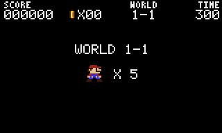
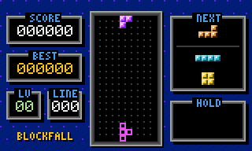
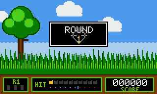
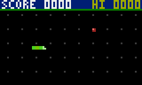

# 8bit-arcade 👾

Retro 8-bit games that run right in your terminal: real pixels, the NES colour
palette, chiptune sound effects, high scores, and one-key recording to GIF so you
can share your best runs.

```sh
npx 8bit-arcade
```

| Pipe Runner | Blockfall | Duck Blaster | Snake |
| :-: | :-: | :-: | :-: |
|  |  |  |  |

_Every GIF above was recorded by the arcade's own recorder._

## Games

| # | Game | Command | Tribute to | Controls |
| - | ---- | ------- | ---------- | -------- |
| 1 | **Pipe Runner** | `8bit mario` | Super Mario Bros. (1985) | `←` `→` run · `↑`/`Space` jump (hold for higher) |
| 2 | **Snake** | `8bit snake` | the classic (1976) | arrows / `WASD` |
| 3 | **Blockfall** | `8bit tetris` | Tetris (1984) | `←` `→` move · `↑`/`X` rotate · `Z` rotate back · `↓` soft drop · `Space` hard drop · `C` hold |
| 4 | **Duck Blaster** | `8bit duck` | Duck Hunt (1984) | mouse to aim and click to shoot, or arrows + `Space` |

In every game: `P` pause · `R` start/stop recording · `Q`/`Esc` pause, then `Q` again to quit.

- **Pipe Runner**: two worlds (overworld 1-1 and underground 1-2). It has `?` blocks, power-up mushrooms, breakable bricks, stompable walkers, spiky shells you can't stomp, pits, a timer, a flagpole bonus and a castle.
- **Snake**: speeds up as you eat, with timed bonus food. On *easy* the walls wrap around.
- **Blockfall**: SRS rotation with wall kicks, a 7-bag randomiser, ghost piece, hold, lock delay, and NES-style scoring and gravity curve.
- **Duck Blaster**: 10 ducks per round, 3 shots per duck, three duck types worth different points, a dog that laughs at you, and harder rounds as you go.

## Install

```sh
npm install -g 8bit-arcade   # then run: 8bit
# or try without installing
npx 8bit-arcade
```

Requires Node.js 18+. It has **no dependencies**.

## CLI

```text
8bit                         open the arcade menu
8bit play <game> [options]   jump straight into a game (also: 8bit <game>)
8bit list                    list games
8bit scores [game]           show high scores
8bit settings                edit settings (interactive)
8bit settings get [key]      print settings
8bit settings set <k> <v>    change a setting, e.g. 8bit settings set difficulty hard
8bit settings reset          restore defaults
8bit recordings              list saved recordings
8bit replay [file|latest]    replay a recording in the terminal
8bit share [file|latest]     share a recording (GIF, share text, X/Twitter link)
    --copy                   copy share text to the clipboard
    --open                   reveal the GIF in your file manager
    --upload                 upload the .cast to asciinema.org (asks first)

Play options
  -r, --record                 record the session
  --difficulty easy|normal|hard
  --fps 20|30|60
  --no-sound
```

## Recording and sharing

Press **`R`** in any game, or start with `8bit play <game> --record`. When you stop
or leave the game, the arcade saves two files:

- **`.gif`**: an animated GIF at crisp pixel scale. Drop it into X, Discord, Slack
  or a GitHub README.
- **`.cast`**: an [asciicast v2](https://docs.asciinema.org/manual/asciicast/v2/)
  terminal recording. Replay it with `8bit replay`, play it in any asciinema player,
  or upload it with `8bit share --upload` to get a public link.

The share screen opens on its own after a recorded game. You can also reach it from
**Recordings & sharing** in the menu. From there you can copy a share message, open
the GIF's folder, open a pre-filled X post, replay the run, or upload it.

> Uploading only happens when you press `u` (or pass `--upload`) and confirm. The
> recording is then public on asciinema.org. If you have the asciinema CLI set up,
> uploads go to your existing account.

## Settings

| Setting | Values | |
| --- | --- | --- |
| `playerName` | text (max 10) | name on the high-score table |
| `difficulty` | `easy` `normal` `hard` | speed, lives, enemies, starting level |
| `sound` | `true` `false` | chiptune effects through `afplay` (macOS), `aplay`/`paplay` (Linux) or PowerShell (Windows) |
| `colorMode` | `auto` `truecolor` `256` | switch to `256` if colours look off |
| `fps` | `20` `30` `60` | lower it over SSH or on slow terminals |
| `recordByDefault` | `true` `false` | record every game automatically |
| `gifScale` | `2` `3` `4` `6` | pixel size of exported GIFs |
| `showFps` | `true` `false` | FPS counter in the status line |

Settings, scores and recordings live in `~/.config/8bit-arcade/`. Set `XDG_CONFIG_HOME`
or `EIGHTBIT_HOME` to move them.

## Terminal tips

- **Size**: games need at least **80×24**. The big banner appears at 80×26 and up.
- **Best controls**: terminals that support the
  [kitty keyboard protocol](https://sw.kovidgoyal.net/kitty/keyboard-protocol/)
  report real key *releases*, so holding run and jump at the same time works
  perfectly. These include kitty, Ghostty, WezTerm, Alacritty, foot and recent iTerm2.
  Other terminals still work: the arcade guesses held keys from key-repeat.
- **Colours**: truecolor terminals look best. macOS Terminal.app falls back to 256 colours.
- **Mouse**: Duck Blaster uses standard SGR mouse reporting, which works in nearly
  every modern terminal and in tmux with `set -g mouse on`.

## How it works

- **Pixels**: each terminal cell shows two vertical pixels with `▀` (foreground =
  top, background = bottom), so pixels come out roughly square. Every game draws
  into an 80×48 framebuffer of NES palette indices.
- **Renderer**: the renderer diffs each frame against the last one and only sends
  the cells that changed.
- **Game loop**: game logic runs on a fixed 60 Hz timestep. Rendering runs at your
  chosen FPS.
- **Recorder**: the recorder snapshots the framebuffer at 15 fps. Because frames are
  palette-indexed, the built-in GIF encoder (LZW, frame diffing, merging of identical
  frames) stays tiny and fast.
- **Sound**: a small square/noise synth renders each effect to a WAV once and plays it
  with your OS's audio player.

```
bin/8bit.js            CLI entry
src/cli.js             commands and flags
src/app.js             menu, settings, scores, recordings, share screens
src/core/              terminal, input, renderer, framebuffer, font, palette, runner, sound, config, scores
src/record/            recorder, GIF encoder, asciicast read/write/replay
src/games/             pipe-runner/, snake.js, blockfall.js, duck-blaster.js
```

### Adding a game

A game is a class with a few static fields and three methods:

```js
export default class MyGame {
  static id = 'my-game'; static title = 'My Game'; static short = 'mine';
  static aliases = []; static year = 1982; static description = '…';
  static controls = 'arrows move'; static width = 80; static height = 48;
  static mouse = false; // true to receive this.pointer / this.clicks

  constructor({ sound, difficulty, best }) { this.score = 0; }
  update(input) { /* 60 Hz. input.down('left'), input.pressed('fire'), input.keyPressed('c') */ }
  draw(fb) { /* fb.clear(c), fb.rect(), fb.sprite(), fb.text() */ }
  // set this.gameOver = true (and optionally this.won = true) to end
}
```

Register it in `src/games/index.js`.

## Development

```sh
npm start        # run the arcade from source
npm test         # headless tests: input parsing, all games simulated, encoders
```

## Legal

Pipe Runner, Blockfall and Duck Blaster are original games with original sprites,
made as tributes to classic 1980s titles. They are not affiliated with or endorsed by
Nintendo or The Tetris Company. *Super Mario Bros.*, *Duck Hunt* and *Tetris* are
trademarks of their respective owners.

MIT licensed.
